 

**Building things because doing it manually sucks.** 🐾🌌

## `> sniff --whoami`

I'm a developer (and a furry 🐾) from Germany with a nose for tools that solve real problems.

A lot of my work revolves around **automation**, **spatial data**, and turning repetitive workflows into software. When I'm not digging through GIS layers and databases, I'm usually tinkering with self-hosted infrastructure or building tools for the things I enjoy – like rolling dice at the tabletop. 🎲

| | |
|---|---|
| 🗺️ **Sniffing out spatial data** | PostgreSQL · PostGIS · QGIS |
| ⚡ **Chewing on code** | TypeScript · React · Node.js |
| 🏠 **Building the den** | Docker · Linux · Caddy · nginx |
| 🎲 **Currently chasing** | Foundry VTT · D&D tooling |

## `> ls ~/toybox`

**Development**

**Data & Infrastructure**

## `> dig --projects`

<table>
<tr>
<td width="50%" valign="top">

### 🔄 [PropSync](https://github.com/ragnaykja/propsync)

Property synchronization for **Obsidian**.
Group your notes, define shared fields once – missing properties get added automatically, nothing gets overwritten.

🦴 TypeScript

</td>
<td width="50%" valign="top">

### ⚔️ [Better Combat Cards](https://github.com/ragnaykja/foundry-better-combat-cards)

A **Foundry VTT** module that makes combat chat cards prettier and easier to read.

🦴 JavaScript

</td>
</tr>
<tr>
<td width="50%" valign="top">

### 👁️ [Hide Group Bars](https://github.com/ragnaykja/foundry-hide-groupbars)

A tiny **Foundry VTT** module with one job:
hide the stuff you don't need.

🦴 JavaScript

</td>
<td width="50%" valign="top">

### 🌦️ [Easy Weather](https://github.com/ragnaykja/foundry-esay-weather)

Weather tooling for **Foundry VTT**.
Because even imaginary worlds need a forecast – and someone has to know when it's too rainy for walkies.

🦴 JavaScript

</td>
</tr>
</table>

## `> cat philosophy.txt`

> **If I have to do it twice, I'm probably going to automate it.**
> *Then I'll go watch the northern lights.* 🌌

 

  

