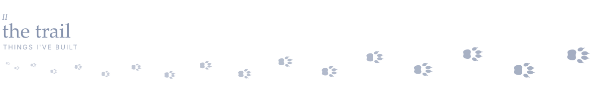
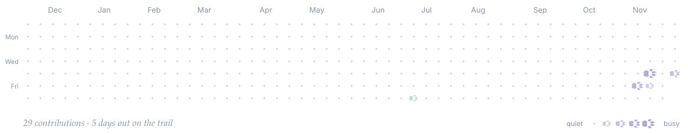
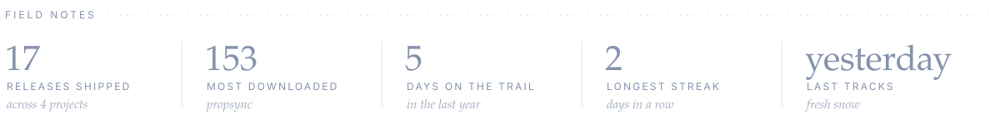

 

Hi, I'm **Ragna** – a developer from Germany who likes the quiet kind of tools:
you set them up once, forget about them, and they just keep doing the work.

Most of my trails lead somewhere between **automation**, **spatial data** and **tabletop games** –
maps and spatial data in PostGIS and QGIS, plugins that tidy up my notes in Obsidian,
and small modules that make game nights in Foundry VTT run a little smoother.

> *If I have to do it twice, I'm going to automate it.*

usually found with &nbsp;·&nbsp; TypeScript &nbsp;·&nbsp; JavaScript &nbsp;·&nbsp; Node.js &nbsp;·&nbsp; React &nbsp;·&nbsp; PostgreSQL / PostGIS &nbsp;·&nbsp; QGIS

 

*A few things I've left along the way:*

**[PropSync](https://github.com/ragnaykja/propsync)** &nbsp;Obsidian plugin · TypeScript 
Keeps note properties in sync across a group – fills in what's missing, never overwrites what's there.

**[Better Combat Cards](https://github.com/ragnaykja/foundry-better-combat-cards)** &nbsp;Foundry VTT · JavaScript 
Calmer, more readable combat chat cards, so the table can focus on the fight.

**[Easy Weather](https://github.com/ragnaykja/foundry-esay-weather)** &nbsp;Foundry VTT · JavaScript 
Weather for imaginary worlds – because even a fantasy forecast deserves to be right.

**[Hide Group Bars](https://github.com/ragnaykja/foundry-hide-groupbars)** &nbsp;Foundry VTT · JavaScript 
One small job: hide the bars you don't need.

 

*Some weeks the snow stays untouched. Some weeks it doesn't.*

  

  

  

